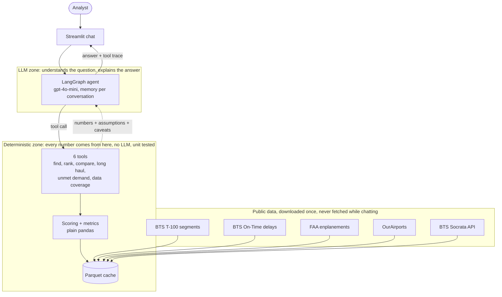

# Airport Investment Intelligence Agent

A chat agent that helps analysts screen US airports for terminal-expansion potential. 

**The one-line design:** all numbers and rankings come from deterministic Python code over public BTS/FAA data. The LLM (gpt-4o-mini) chooses which tool to call and explains the result in plain language.

## Setup (Windows)

```powershell
py -m venv .venv
.\.venv\Scripts\python -m pip install -r requirements.txt
copy .env.example .env   # then put your OPENAI_API_KEY in .env
```

## Run

```powershell
.\.venv\Scripts\python -m airport_agent.data.build_cache   # one-time: downloads and caches all data (about 25 min the first time)
.\.venv\Scripts\streamlit run app.py                       # chat UI
.\.venv\Scripts\python -m airport_agent.agent              # or: terminal chat
.\.venv\Scripts\python -m pytest                           # 33 tests, no network or LLM needed
```

Questions it handles (the sidebar has them as one-click examples):

- Which airports in New England are strong candidates for terminal expansion?
- Compare LA and Santa Ana airport congestion levels.
- What is the percentage of long haul flights out of Anchorage airport?
- What is the unmet flight demand in SFO airport and why?

You can also ask by voice with the microphone button inside the chat box: the recording is transcribed to text and sent through the same agent as a typed question. Follow-ups work ("and how does Boston compare to Providence?", "what if I count 2,500 miles as long haul?").

---

# Design

## Architecture



The LLM never touches data. It asks a tool, the tool computes the answer from the cached tables, and the numbers come back with their assumptions and caveats. Everything in the deterministic zone runs with no LLM and no network, which is why it is unit tested. Each answer in the chat shows the tool calls behind it.

## Data sources

| Source | Used for | How it is fetched |
|---|---|---|
| **BTS T-100 Segment (All Carriers)** | passengers, seats, departures, distance, per route per month. Domestic and international, US and foreign carriers | Form download on TranStats (no API exists), cached |
| **BTS On-Time Performance** | delay rate, taxi-out time, delay causes | Monthly zip files (no API exists), shrunk to one row per airport per month, cached |
| **FAA enplanements** | independent check of T-100 passenger counts, hub class | One spreadsheet per year |
| **OurAirports** | names, cities, states, for finding airports and defining regions | One CSV |
| **BTS Socrata API** (`International_Report_Passengers`) | cross-check of international passenger counts. The only true REST API used | SoQL query, aggregated on the server |

T-100 and On-Time have no API, so they are fetched programmatically and cached. The agent never touches the network while chatting.

**Years:** 2019 (pre-COVID baseline) and 2022 to 2025. 2020 and 2021 are skipped because COVID makes them useless for trend.

**Cross-checks that passed.** T-100 departing passengers match FAA enplanements within about 1% (BOS 2024: 21.31M vs 21.09M). T-100 international passengers match Socrata exactly for 2019, but differ by 1 to 4% in 2024 (BOS 8.87M vs 8.54M). We did not investigate the cause (probably a revision or scope difference), so treat international totals as approximate.

## Metrics

One row per airport per year, computed in [metrics.py](airport_agent/metrics.py). Traffic is counted on the **departure side** (flights and passengers leaving the airport), matching how the FAA counts enplanements. Only passenger service is counted (T-100 classes F and L); all-cargo rows are dropped.

- `load_factor` = passengers / seats
- `long_haul_share` = share of departing flights on a nonstop segment of **3,000 miles or more**
- `passengers_vs_2019`, `passengers_yoy`, `seats_yoy` for growth (year-over-year is only computed when the previous calendar year is loaded)
- `delay_rate`, `avg_taxi_out_min`, `nas_delay_share`, `cancel_rate` from On-Time

## Scoring methodology

All scores are percentile ranks (0 to 100, 100 = best or most) **among eligible US airports**, so one huge outlier such as JFK cannot squash everyone else, and a score reads as "better than X% of peers". In 2025, 190 airports are eligible. Weights and thresholds live in [config.py](airport_agent/config.py).

### Expansion-candidate score

The question it answers: *is demand outgrowing the airport?*

```
score = 40% load factor + 40% momentum + 20% seat growth
momentum = average of the percentiles of (passengers vs 2019) and (passengers year over year)
```

- **Load factor**: full planes suggest passengers are being squeezed.
- **Momentum**: demand is growing, or has recovered beyond pre-COVID levels.
- **Seat growth**: airlines are adding capacity, so they expect demand.

Rules around the score:

- **Size floor:** airports with fewer than 5,000 passenger departures a year are not scored. Tiny airports have noisy ratios and would dominate the extremes.
- **Load-factor gate:** an airport under 60% load factor is scored but **not ranked**. Real data showed why: Hyannis, Block Island and Westerly ranked in the national top 100 on growth alone while flying planes under 50% full. Growth on empty planes is not evidence the terminal is too small.
- **Warning flags** travel with each result and never change the score: small airport (under 250,000 passengers), traffic above 3x its 2019 level (likely new service, e.g. New Haven at 15x), seats up over 50% in a year, and missing components.
- **Missing data:** if a component is unavailable, the remaining weights are rescaled and the airport is flagged.

Strain (delays) and scale (total passengers) are deliberately **not** in this score. Delays have too many non-terminal causes, and scale would just favor the biggest airports. They are reported separately.

### Congestion index

Equal-weight average of the percentiles of `delay_rate`, `avg_taxi_out_min` and `nas_delay_share` (delay caused by airport and airspace system limits, the closest thing to a capacity signal). 100 = most congested.

### Unmet-demand proxy

There is no free data on passengers turned away, so this looks for the symptoms: the average of the percentiles of load factor, growth vs 2019, and the congestion index. Levels: under 33 low, 33 to 67 medium, over 67 high. It is a screening signal and the agent is instructed to say so every time.

### Example results (2025)

| Question | Result |
|---|---|
| New England candidates | Bangor (BGR) ranks 11th nationally, Portland (PWM) 23rd, New Haven (HVN) 40th (flagged: 15x its 2019 traffic). Hyannis, Block Island and Westerly are gated out for low load factor. Boston ranks 89th: full planes but flat growth |
| LAX vs SNA congestion | SNA 54.9 vs LAX 50.0 (SNA slightly more congested, mostly from a higher delay rate, 19.4% vs 17.8%) |
| Anchorage long haul | 2.8% of departing flights at 3,000 miles; 9.8% at 2,500; 13.8% at 2,000 |
| SFO unmet demand | Medium (56.5): high load factor (82%, 88th percentile) and congestion (66th percentile), but traffic is still 5% below 2019 |

## Where AI is used (and where it is not)

**The LLM does:** understand the question, pick tools and arguments (for example turn "Santa Ana" into `SNA` via `find_airport`), and write the explanation.

**The LLM does not:** compute, rank, score or look up any number. Every figure in an answer comes from a tool result. The system prompt forbids estimating or doing arithmetic on tool numbers.

**Built-in honesty:** every tool result carries `assumptions` and `notes` (year, definitions, sampled months, flags, "proxy only") which the agent must repeat. The chat UI shows each tool call and its raw JSON under every answer, so an analyst can verify where a number came from.

**What testing the LLM found.** Two real problems, both fixed by changing the tool output rather than hoping the prompt works:

1. For SFO the model reported "load factor: 88.4%" and "traffic increase of 14.7%", but those were percentile ranks. Percentile fields are now named `*_percentile`, real values are provided separately, and the prompt explains the difference.
2. For Anchorage it computed a wrong departure count itself. The tool now returns counts and a pre-written `summary`, and the prompt forbids arithmetic.

## Key tradeoffs

- **Deterministic code with a thin LLM, vs an LLM reasoning over raw data.** Less flexible, but numbers are reproducible, testable and explainable. This is the main design bet.
- **Percentile ranks vs min-max or z-scores.** Percentiles are robust to outliers and easy to explain, but they discard magnitude: being 1st and 2nd can mean almost the same thing or a huge gap.
- **Bulk download and cache vs live APIs.** The key sources have no API. Caching makes chat fast and offline, at the cost of a slow first build and data that is only as fresh as the last build.
- **Sampled On-Time months.** Each month is about 30 MB and takes about a minute, so we use January, April, July and October of each year instead of all 12. Delay figures are seasonal estimates, not full-year numbers.
- **Explicit LangGraph instead of the prebuilt agent.** About 30 lines, easier to explain and extend.
- **Weights are a judgement call.** 40/40/20 is a defensible default, not a fitted result. They sit in one config dict so an analyst can change them.

## Assumptions, uncertainty and limitations

- **Capacity is inferred, never measured.** There is no gate, runway or terminal-size data in free sources. The score is a screening signal for demand outgrowing capacity. It says nothing about terminal condition, land, financing or returns.
- **"Long haul" is our definition** (3,000 miles or more) and Anchorage's answer is very sensitive to it, so the agent always reports the 2,000 to 3,500 mile range. It counts nonstop legs, not whole trips.
- **Unmet demand is a proxy**, not a measurement.
- **Percentiles are relative to the eligible national field** (190 airports in 2025), not to the region asked about.
- **Ambiguous places:** "LA" is resolved to LAX. BUR, LGB and ONT are available on request (there is also a "los angeles area" region).
- **Foreign origins** are excluded from airport metrics (only US origin airports are analysed).
- **In-memory conversation memory** is lost when the server restarts.
- **LLM behavior is not covered by automated tests.** The 33 tests cover everything except the model's wording. We checked the four assignment questions and follow-ups by hand.
- **International totals** differ by 1 to 4% between T-100 and Socrata in 2024 (see above).
- **Voice is input only**: answers are not read aloud. Transcription (OpenAI `gpt-4o-mini-transcribe`) can mishear names, so the transcript is shown as your message and a vocabulary hint of airport codes is sent with each recording. The transcription call is tested with a fake client and a real text-to-speech round trip; the microphone click itself was not tested.

---

# How I worked with AI on this project

I built this with Claude Code as a pair, but I stayed the decision-maker. I worked in small, reviewable steps.

1. **Plan first, no code.** I started by asking for research and a plan only. Claude tested the public data sources with real requests (which APIs exist, what needs a key, what is slow) before we wrote anything. I reviewed the plan and sent it back with corrections, for example to use the T-100 table that includes international flights, which years to load, the 3,000-mile long-haul threshold, and to use a real API (Socrata) somewhere visible.
2. **One step at a time.** Scaffold, data layer, metrics, scoring, agent, UI, docs. After each step Claude explained what it built in plain words and how to run and test it. I approved before every commit.
3. **I made the key design choices.** Before any scoring code, Claude laid out the options and trade-offs and I chose the metrics, normalisation and size floor. When the real results showed tiny airports ranking high on growth alone, I picked the fix (a load-factor gate plus warning flags).
4. **I tested it myself and pushed on problems.** I ran the agent with my own API key and questions. End-to-end testing exposed two real bugs: the model presented percentile ranks as percentages for SFO, and it did its own arithmetic for Anchorage and got a wrong count. We fixed them by changing the tool output (clearer field names, returned counts, pre-written summary lines) instead of only tweaking the prompt.
5. **Verification, not trust.** Each step has tests with hand-computed expectations, and I checked results against known numbers (BOS passengers against FAA enplanements, international passengers against the Socrata API).

What AI did well here: researching sources quickly, boilerplate, and writing tests. What needed my judgment: scoring choices, definitions such as "long haul", and deciding when a result looked wrong.
